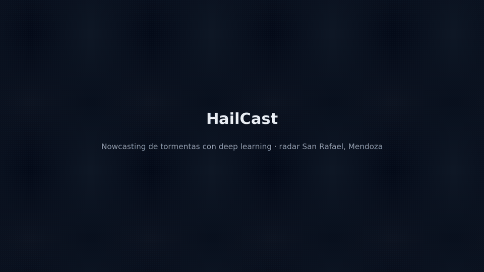
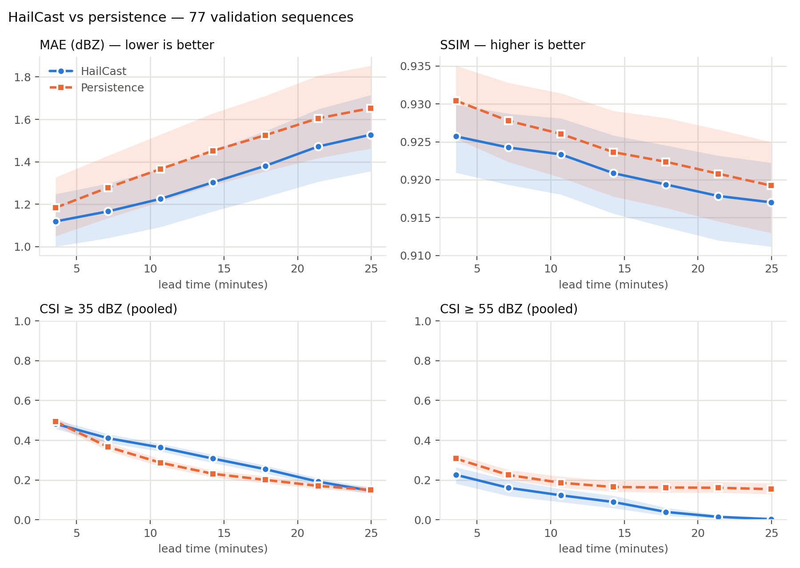
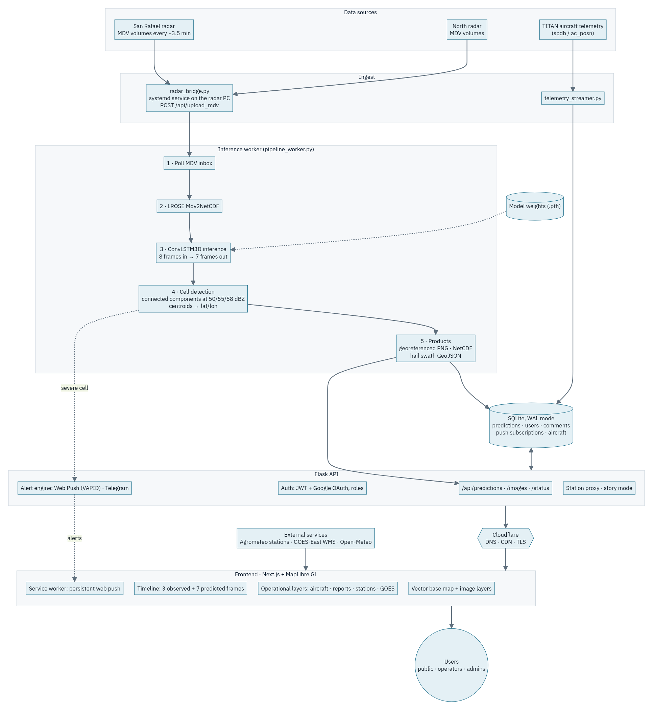
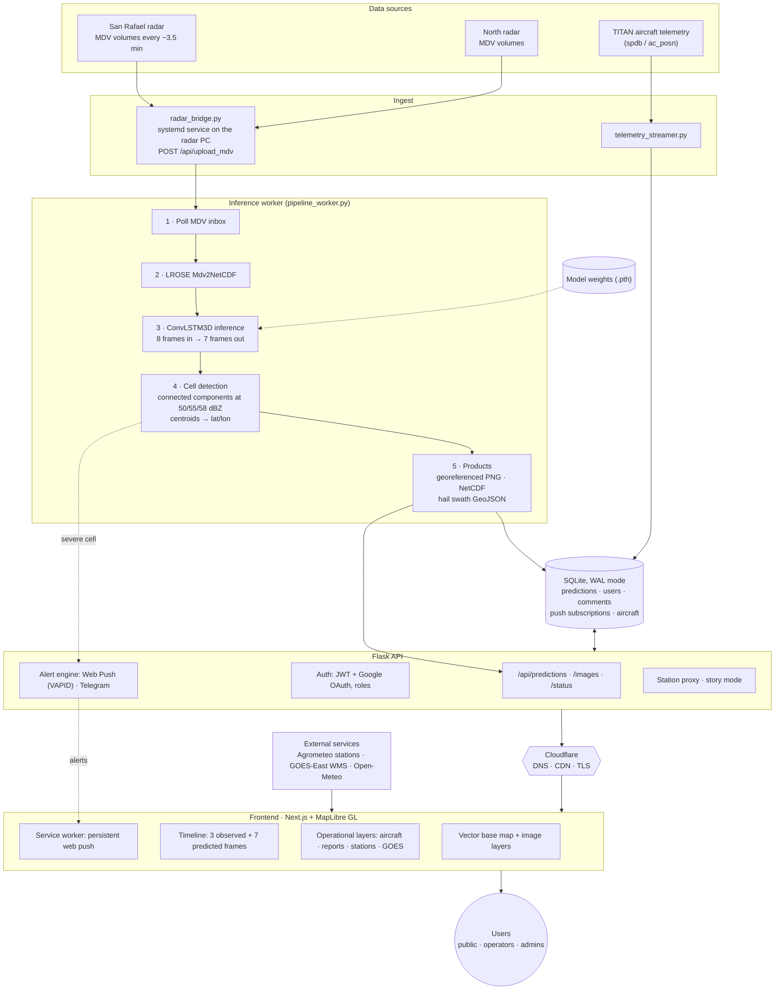

# HailCast

**Deep learning nowcasting of severe convective storms from weather radar. Running in production for Mendoza, Argentina.**

[Live system](https://www.hail-cast-mendoza.com) · [Evaluation report](training/results/baseline_ampliado/resumen.md) · [Training details](training/README.md) · [Deployment notes](deploy/README.md)



*Left: what the radar observed. Right: what HailCast had predicted from the previous 8 scans, 3 to 25 minutes earlier. Three storms from the 2025–2026 validation set; both panels show echoes ≥ 30 dBZ in the TITAN palette. Rendered with [`training/render_demo_video.py`](training/render_demo_video.py).*

HailCast takes the last radar scans of a storm and predicts the next seven, roughly 25 to 30 minutes ahead depending on radar cadence. It replaces the linear extrapolation used by operational systems (TITAN) with a ConvLSTM network that learns the non-linear dynamics of convection directly from a multi-year radar archive: cell growth, merging, intensification and decay.

It was built end to end as my engineering thesis at Universidad de Mendoza (graded 10/10) and has been running as a public service since the 2025–2026 hail season, where radar operators used it to support cloud-seeding decisions and the general public checked it during storms.

---

## Why it matters

Mendoza's economy depends on vineyards and orchards that hail can destroy in minutes. According to the agricultural-risk records of the provincial Dirección de Agricultura y Contingencias Climáticas (DACC), hail damage across Mendoza's productive oases has averaged the equivalent of **15,200 hectares at total loss per season** over the last twenty years, with cloud seeding in operation, and close to **30,000 hectares per season** in the seasons without it.¹

Hail mitigation and public warnings rely on Lagrangian extrapolation (TITAN), which treats a storm as a rigid object moving in a straight line. By construction it cannot see the processes that determine severity: explosive genesis, cell merging, sudden intensification or decay. The result is late warnings and false alarms.

## What HailCast does differently

- **Learns the dynamics instead of extrapolating.** A three-layer stacked ConvLSTM encodes the input sequence into a spatiotemporal state; a 3D convolutional head projects seven future reflectivity frames.
- **Fights blurring by design.** Recurrent forecasting models smooth intense cores. HailCast trains with a hybrid loss (Huber + weighted high-reflectivity penalty + SSIM) and a three-phase curriculum: first intensity and location, then structure and advection.
- **Preserves the physics of the data.** The radar archive is converted from the proprietary MDV format to NetCDF with the LROSE scientific suite, keeping reflectivity scale and offset intact, and predictions are written back to MDV so TITAN can consume them.
- **Runs on cheap hardware.** Inference takes ~8 s per forecast on a low-cost CPU VPS, on par with GPU, with no quantization.

## Results

Validated on **77 storm sequences from the 2025–2026 season** (21 multicell, 21 supercell, 20 advection-dominated, 15 weak convection), selected in TITAN under a [criterion fixed before running the pipeline](training/results/baseline_ampliado/criterio_seleccion.md), with a model trained only on 2006–2014 data. The whole validation set is out of sample by more than a decade. Every metric is compared against **persistence** (the last observed frame repeated), the baseline any nowcasting system has to beat, with 95% bootstrap confidence intervals over 1,000 resamples of the sequences.

| Lead time | MAE (dBZ) HailCast / Persistence | CSI ≥ 35 dBZ HailCast / Persistence | CSI ≥ 55 dBZ HailCast / Persistence |
|---:|:---:|:---:|:---:|
| 3.6 min (t+1) | **1.12** / 1.18 | 0.48 / **0.50** | 0.23 / **0.31** |
| 14.3 min (t+4) | **1.30** / 1.45 | **0.31** / 0.23 | 0.09 / **0.17** |
| 25.0 min (t+7) | **1.53** / 1.65 | 0.15 / 0.15 | 0.00 / **0.15** |

Full tables by lead time and storm type, bootstrap intervals and the case list: [`training/results/baseline_ampliado/`](training/results/baseline_ampliado/). The original 13-sequence evaluation is kept unchanged in [`training/results/baseline/`](training/results/baseline/) and is reproduced exactly by the expanded run. CSI is pooled (hits, false alarms and misses summed over all sequences before dividing).



**Where HailCast wins.** Lower MAE at every lead time and in all three severe storm types (95% CI excludes zero). Higher CSI at the 35 dBZ convection threshold between 7 and 21 minutes, with the largest gain at 14 minutes: +0.08, 95% CI [+0.05, +0.10]. The gain holds in each severe type: multicell +0.11, supercell +0.08, advection +0.08. At the first and last lead times the two tie. SSIM stays above 0.89 at every lead time and storm type.

**Where it loses, and why.** At the 55 dBZ severe-hail threshold, persistence wins at every lead time (−0.08 at t+1, −0.15 at t+7, CI excludes zero), and at the longest horizon the model almost never predicts pixels that intense. In weak convection (15 cases with no sustained severe cell) persistence wins on every metric: the model's smoothing and its 30 dBZ post-processing threshold erase weak echoes that persistence simply keeps. SSIM is slightly but consistently lower. All of this comes from the same cause: the model still smooths reflectivity peaks and faint echoes, while persistence copies the field intact and a severe core tends to sit in place for several minutes. The hybrid loss reduced this but did not eliminate it. See [Limitations](#limitations).

## System architecture



<details>
<summary>Diagram source (Mermaid)</summary>



</details>

- **Producer–consumer split.** A pipeline worker watches for new radar volumes, converts, runs inference and pre-renders georeferenced PNGs. A lightweight Flask API serves state and assets. SQLite in WAL mode synchronizes both.
- **Resilient by design.** Pre-rendered assets behind a Cloudflare CDN decouple the public map from the inference host, so the system held real concurrent traffic during storm events.
- **Two radar sites.** The pipeline ingests the northern Mendoza radar as well as San Rafael, each with its own geographic bounds and alert thresholds.
- **Alerts.** Severe-cell detection triggers push notifications and Telegram messages, with per-radar minimum levels.
- **Story mode.** Replays any past storm with observed and predicted frames side by side, synchronized with the cloud-seeding aircraft telemetry when available.

## Model and training

| | |
|---|---|
| Input / output | 8 radar frames in → 7 frames out (sequences of 15 scans: ~24–32 min of context, 25–30 min of forecast) |
| Resolution | 250 × 250 composite reflectivity (2× downsampling from the native 500 × 500 grid), upsampled back for display and TITAN |
| Architecture | 3 stacked ConvLSTM layers, 128 hidden channels, 3×3 kernels, LayerNorm after each layer, Conv3D head (1×3×3) with sigmoid output predicting the 7 frames at once |
| Loss | Huber + weighted squared-error penalty inside observed pixels above 35 dBZ (weight 100 → 50 → 25 across phases) + (1 − SSIM) (weight 0.1 → 20 → 30) |
| Curriculum | Phase 1 intensity and location → Phase 2 structure and advection → Phase 3 refinement |
| Data | San Rafael S-band radar archive, 2006–2014: 2,600 sequences of 15 scans, balanced by storm morphology (advection, multicell, supercell), sliding-window augmentation |
| Hardware | NVIDIA H200, ~12 h |

Details, hyperparameters and the full curriculum: [`training/README.md`](training/README.md).

## Limitations

- **Severe-hail cores at long lead times.** CSI at 55 dBZ is below persistence. The useful window for severe-hail location is the first 18–21 minutes. A warning product built on HailCast should say where convection is heading (where the model adds skill) and defer to the latest scan for the exact position of the most intense core.
- **Weak convection.** With no severe cell in the input, the model underperforms persistence on every metric. HailCast is a tool for convective situations; a product built on it should fall back to the latest scan when nothing severe is on the screen.
- **Validation set.** 77 sequences from one season and one radar; storm types were labeled by an analyst in TITAN. Decaying-storm cases were not sampled separately.
- **Single-level input.** The model uses composite reflectivity, not the full 3D volume. Vertical structure, which matters for hail, is not yet exploited.
- **Baselines.** Compared against persistence only. Optical-flow extrapolation (e.g. pySTEPS) is the next baseline to add.

## Roadmap

1. An optical-flow baseline (pySTEPS) and a decaying-storm subset in the validation.
2. Residual diffusion correction on top of the ConvLSTM output to recover peak intensities (DiffCast / CorrDiff style), with event-triggered serverless GPU inference.
3. Full 3D radar volumes and the 2015–2024 archive.
4. GOES-East satellite channels as additional input.
5. Transfer to other radar sites: the pipeline is format-open and hardware-independent.

## Running it

Requirements: Docker and Docker Compose. The image downloads LROSE from the [official NCAR release](https://github.com/NCAR/lrose-core/releases/tag/lrose-core-20250105) at build time.

```bash
cp backend/.env.example .env            # set SECRET_KEY, INGEST_SECRET_KEY, VAPID keys, etc.
# place the trained weights in ./model/best_convlstm_model.pth   (see "Model weights" below)
docker compose -f docker-compose.cpu.yml up --build
```

Frontend at `http://localhost:3000`, API at `http://localhost:8000`. For GPU inference use `docker-compose.yml` (NVIDIA Container Toolkit required).

To reproduce the evaluation: `python training/baseline_persistencia.py` regenerates the tables, figures and bootstrap intervals in `training/results/baseline/`.

**Model weights.** The trained checkpoint (~400 MB) is available on request (see Author) while public redistribution is confirmed with the radar data provider. Without it, the stack runs and serves observed radar frames; only the forecast step is skipped.

## Repository layout

```
backend/     Flask API, inference worker, alert and auth services, LROSE parameters
frontend/    Next.js app: MapLibre map, story mode, alerts
training/    training pipeline, evaluation scripts and results
deploy/      supervisord, entrypoints, healthchecks, deployment notes
tools/       radar bridges and watchers for the two radar sites
scripts/     backups, telemetry streamer, simulators
```

## Author

**Federico Raúl Caballero** · Ingeniería en Informática, Universidad de Mendoza (2026) · [LinkedIn](https://www.linkedin.com/in/federico-caballero1/) · federicorcaballero@gmail.com

Ten years as a weather radar analyst and cloud-seeding flight coordinator at Aeronáutica Mendoza, which is where the problem, the data intuition and the obsession with honest evaluation come from.

Thesis supervision: Mgter. María Marta Arrieta Guevara (academic advisor), Ing. Gabriel Federico Pulido (technical advisor). Historical radar data courtesy of Dr. Ing. Horacio Gabriel Pessano.

## License and data

Code is released under the [MIT License](LICENSE). The radar archive used for training belongs to the Dirección de Agricultura y Contingencias Climáticas (DACC) of Mendoza and is not included in this repository. Model weights are distributed separately (see above).

---

¹ DACC, *Riesgo Agrícola*, hail damage summed over Mendoza's productive oases, expressed as hectares brought to 100% loss, seasons 1993/94–2023/24 (chart by Prof. Marcelo Peña, Centro de Operaciones). Averages: 29,968 ha/season without cloud seeding (1993–1998), 20,786 ha/season under the Weather Modification Inc. contract (1998–2004), 15,238 ha/season under the provincial program (2004–2024).
